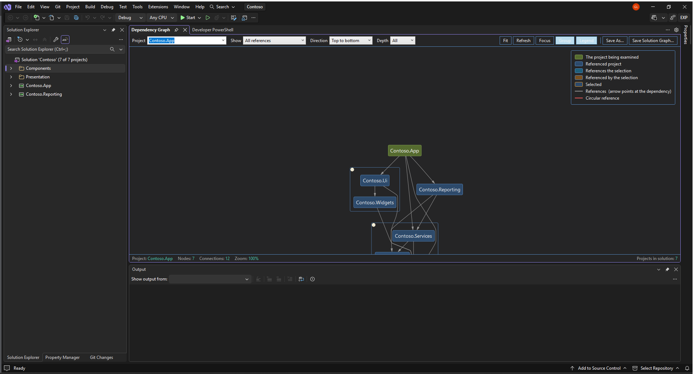
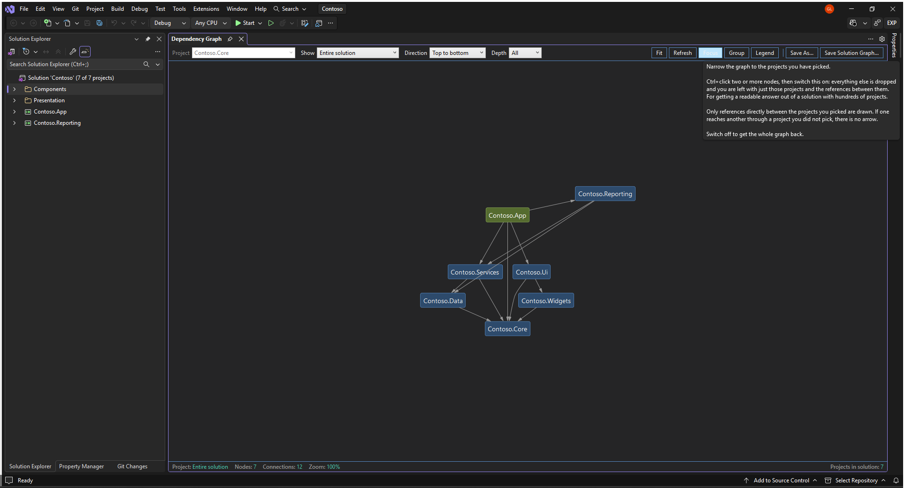
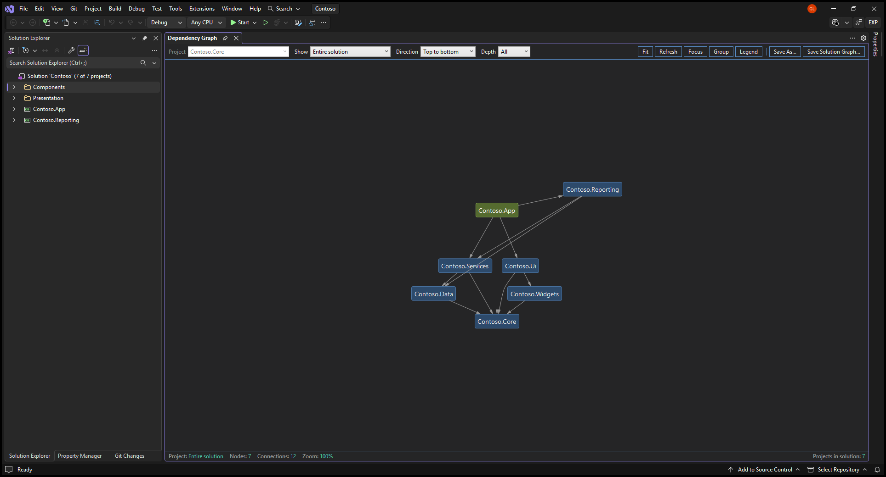
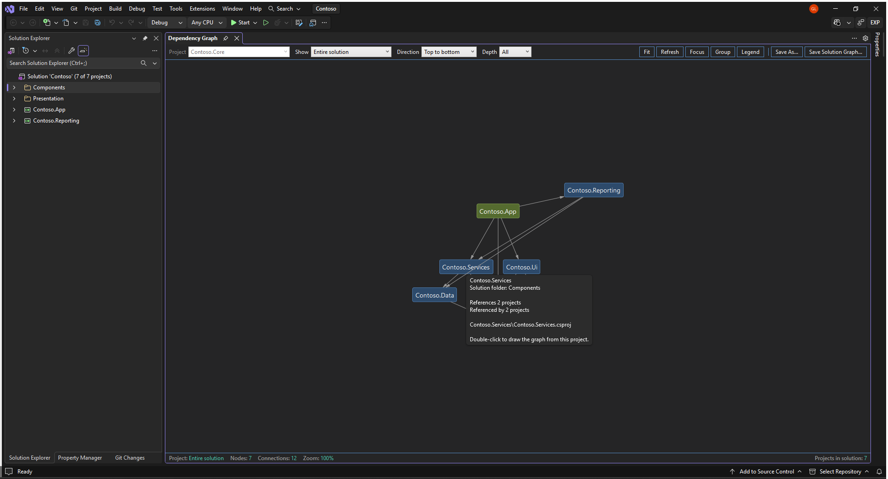
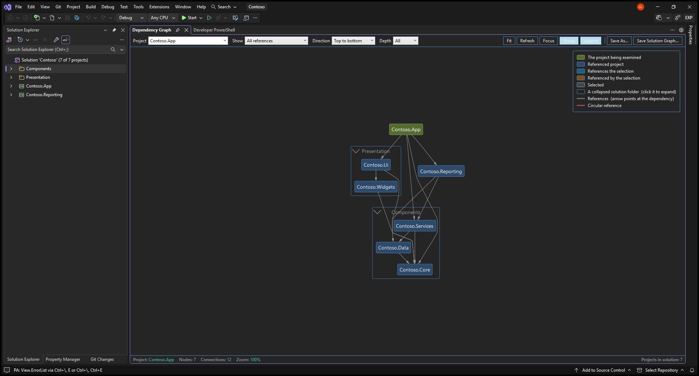
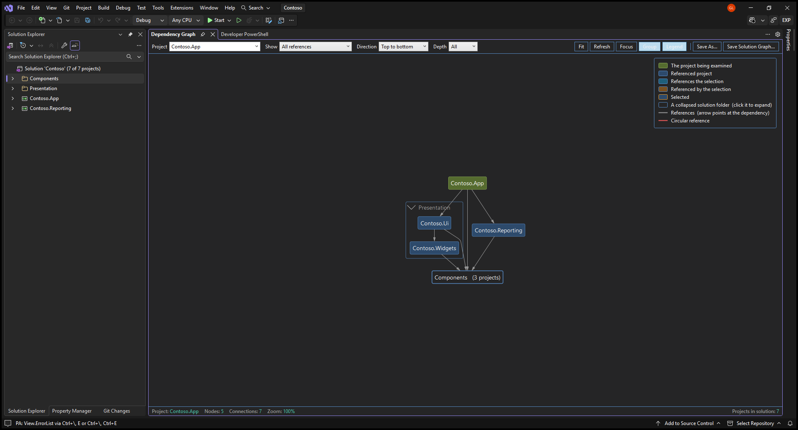

# DependencyGraph

A Visual Studio extension that draws your solution's project-to-project reference graph in a
dockable tool window — laid out properly, not just dumped to a file.

Useful when you are working out what a project actually drags in, why a build takes so long,
whether a reference can be removed, or where a circular reference crept in.



## Contents

- [What you see](#what-you-see)
- [Installing](#installing)
- [Requirements](#requirements)
- [Opening it](#opening-it)
- [The command bar](#the-command-bar)
- [Views](#views)
- [Getting around](#getting-around)
- [Highlighting](#highlighting)
- [Circular references](#circular-references)
- [Exporting](#exporting)
- [Options](#options)
- [Grouping by solution folder](#grouping-by-solution-folder)
- [Moving things about](#moving-things-about)
- [External references](#external-references)
- [When the solution changes](#when-the-solution-changes)
- [Themes](#themes)
- [Building from source](#building-from-source)
- [How it works](#how-it-works)
- [Project layout](#project-layout)
- [Tests](#tests)
- [Known limitations](#known-limitations)

## What you see

One box per project, one arrow per reference, pointing from the project that *has* the
reference to the project it depends on.

```
Contoso.App ──────────► Contoso.Services ──────────► Contoso.Core
└────┬────┘             └───────┬───────┘            └─────┬────┘
   root                    depends on                  depended on
 (olive green)
```

The project you are looking at is the root, filled olive green. Everything else is blue. In the
**Entire solution** view there is no root, so olive marks the projects nothing else references —
the solution's entry points.

The graph opens at **100%** zoom so the labels are crisp — use **Fit** when you want the whole
thing in view instead.

The status bar carries the numbers: which project is rooted, how many nodes and connections
are drawn, the current zoom, the selected project with its reference counts, and how many
projects the solution has in total.

## Installing

From the [Visual Studio Marketplace](https://marketplace.visualstudio.com/items?itemName=LokeshGovindu.DependencyGraph),
or by double-clicking a `DependencyGraph.vsix` built from source.

Nothing to configure afterwards. In particular, **you do not need Graphviz** and you do not
need the DGML editor — the graph is drawn inside the IDE. Graphviz is only used if you choose
the SVG or PNG options under [Exporting](#exporting).

## Requirements

| | |
| --- | --- |
| Visual Studio | 2022 (17.x) or 2026 (18.x), `amd64` |
| .NET Framework | 4.8 |
| Graphviz | Optional — only for the Graphviz SVG/PNG exports |

Project references are read through `VSProject.References`, which is a C#/VB/F# facility. C++,
database, shared and unloaded projects appear in the solution count but have no references the
extension can read, so they show up as isolated nodes rather than errors.

## Opening it

Either:

- **Tools → Show Dependency Graph**
- right-click a project in Solution Explorer → **Show Dependency Graph**

The window docks in the document area, and Visual Studio remembers where you put it. It is a
tool window, not a dialog, so the rest of the IDE stays usable while it is open — click around
Solution Explorer and press **Refresh** to rescan.

## The command bar

| Control | Meaning |
| --- | --- |
| **Project** | Which project to root the graph at. Type to search. Greyed out under **Entire solution**, which has no root. |
| **Show** | Which references become arrows — see [Views](#views). |
| **Direction** | `Top to bottom`, `Left to right`, `Bottom to top` or `Right to left`. |
| **Depth** | `All`, or 1–6 levels. Limit this on a large solution. |
| **Fit** | Zoom so the whole graph fits the window. |
| **Refresh** | Rescan the solution — after adding a project or changing references. |
| **Focus** | Draw only the selected projects and the references between them. Ctrl+click nodes to select several. |
| **Group** | Draw a box around each solution folder, named after it. Click the chevron on a box to fold that folder down to one shape. |
| **Legend** | Show what the colours mean. |
| **Save As...** | Export this project's graph — see [Exporting](#exporting). |
| **Save Solution Graph...** | Export *every* project in the solution, not just this one. |

Every control has a tooltip saying what it is for — and, where it matters, what it will not do:



## Views

The **Show** dropdown changes which references are drawn, not which projects:

| View | What it draws |
| --- | --- |
| **Deepest references only** | One arrow per project, from the deepest project that references it. Gives a clean tree — the quickest way to read the shape of a dependency chain. |
| **All references** | Every reference of every project. The honest picture, and busier: a project referenced by four others gets four arrows. |
| **Project references only** | Just the selected project and the things it references directly. Two levels, nothing transitive. |
| **Referenced by (impact)** | Turned around: every project that depends on this one, directly or transitively. What breaks if you change it. Arrows still point at the dependency, so the project you asked about sits at the bottom. |
| **Entire solution** | Every project in the solution and every reference between them, with no root. The other four start at one project and can only reach what that project reaches; this is the one that shows a solution with several entry points whole. |

On the sample solution above, the same seven projects give 6 connections under *Deepest* and
12 under *All*.

The whole solution at once, with the one project nothing else references drawn as a root:



**Depth** is the other lever. `All` follows the references as far as they go; a number stops
after that many levels. Whole levels are cut cleanly — you never get an arrow pointing at a
project that was left out.

## Getting around

| Action | Result |
| --- | --- |
| Drag the background | Pan |
| Drag a node | Move it. Its references follow it, and nothing else shifts. |
| Drag a folder box | Move the whole group - the box, the projects in it and their references. |
| Right-click the background | **Reset dragged positions** - put everything back where the layout wants it. |
| Mouse wheel | Zoom |
| **Fit** | Fit the graph to the window |
| Hover a node | A tooltip with its solution folder, reference counts and path |
| Click a node | Select it; the status bar shows its reference counts and project path |
| Double-click a node | Re-root the graph on that project |
| Right-click a node | Highlighting menu — see below |
| Ctrl+click a node | Add it to the selection, for **Focus** |
| <kbd>Ctrl</kbd>+<kbd>S</kbd> | Save the graph as a PNG |

Hovering a node says the rest - a box only has room for a short name:



## Highlighting

Right-click any node:

- **Highlight projects referencing …** — everything that depends on this project. What breaks
  if you change it.
- **Highlight projects referenced by …** — what this project depends on directly.
- **Show the reference graph of …** — re-root on that project, same as double-clicking.
- **Clear highlighting** — back to the resting colours.

## Circular references

A reference that closes a cycle is drawn in red and labelled `cycle`.

Visual Studio will not let you create a circular project reference through the UI, but a
hand-edited `.csproj` can still produce one and the solution will load — it only fails at build
time, with an error that does not name the projects involved. This points straight at them.

## Exporting

**Save As...** exports the graph currently on screen:

| Format | Notes |
| --- | --- |
| **PNG** | The whole graph, cropped to it — not just the part scrolled into view. |
| **DGML** | Opens in Visual Studio's own directed-graph editor, if you have that component installed. |
| **Graphviz DOT** | Plain text, for `dot` or any other Graphviz tool. |
| **Graphviz SVG / PNG** | Rendered by `dot`. Only offered when `dot.exe` is on your `PATH`. |

**Save Solution Graph...** does the same for every project in the solution at once, in DGML,
DOT, SVG or PNG.

Nodes are identified by the project's solution-relative path rather than its name, so two
projects sharing a name in different solution folders stay separate in the exports.

## Options

**Tools → Options → DependencyGraph → General**:

| Setting | Default | Meaning |
| --- | --- | --- |
| **View** | Deepest references only | Which view the window opens with. |
| **Direction** | Top to bottom | Which direction it opens with. |
| **Depth** | `0` | Depth limit on open. `0` means no limit. |
| **Fit the graph to the window on open** | `false` | Off opens at 100%, which keeps the node text crisp. On fits the whole graph instead. |
| **Node label font size** | `14` | Point size of the project names, 6 to 32. Nodes are sized around their label, so this scales the whole graph. |
| **Excluded projects** | empty | Semicolon-separated name patterns to leave out, e.g. `*.Tests;*.Benchmarks`. `*` and `?` are supported, matching is case-insensitive, and the project you are looking at is never excluded. |
| **Path to dot.exe** | empty | Full path to Graphviz's `dot.exe`. Leave empty to search the `PATH`. |

## Grouping by solution folder

**Group** draws a box around the projects in each solution folder, with the folder's name in a
band across the top of the box. Nested folders nest their boxes. A project that is not in any
solution folder is drawn on its own, outside every box.

Clicking the chevron beside a folder's name collapses it: the whole folder becomes one node
labelled with its name and the number of projects in it, and every reference into or out of the
folder is redrawn against that node. Click the collapsed node to expand it again. On a solution
with a few hundred projects this is the fastest way to something readable.



And with `Components` collapsed to a single node:



## Moving things about

Automatic layout is a starting point, not the last word. Drag a node, or a whole folder box, to
where it reads better; its references follow it and nothing else moves.

What you dragged is remembered as an offset from wherever the layout puts that node, so it
survives a rebuild - changing view, direction or depth, pressing **Refresh**, collapsing a
folder. An offset rather than a fixed coordinate on purpose: every rebuild is a fresh layout, and
a coordinate from the previous one would put the node somewhere arbitrary in the new one.

Right-click the background for **Reset dragged positions** to put everything back.

Offsets are written to `%LOCALAPPDATA%\DependencyGraph\positions`, one small file per solution,
so an arrangement survives closing the solution and closing Visual Studio. Nothing is written
into your repository. Because the file is keyed by the solution's path, moving or renaming the
solution starts again from the layout.

## External references

A project that is referenced but is not itself in the solution is drawn with a dashed border and
labelled `(external)`, because its own references were never scanned — the graph below it is
incomplete by definition.

## When the solution changes

The window follows the IDE. Close the solution and it empties itself; open another and it
rescans and roots on the new solution's startup project. Adding or removing a project while the
window is open updates it too. **Refresh** is there for the case the extension cannot see —
editing a project's references outside the IDE.

## Themes

The graph follows the active Visual Studio theme, and re-colours itself if you switch theme
while the window is open. Every text-on-background pairing meets WCAG AA in both the light and
dark palettes.

## Building from source

```
git clone https://github.com/lokeshgovindu/DependencyGraph.git
```

Open `DependencyGraph.sln` and build, or from a command line:

```
msbuild DependencyGraph.csproj /p:Configuration=Debug /p:Platform=AnyCPU
```

Then <kbd>F5</kbd> to launch the experimental instance. The first time, the extension has to be
installed there by `VSIXInstaller` before F5 deployment will work:

```
VSIXInstaller.exe /quiet /rootSuffix:Exp bin\Debug\DependencyGraph.vsix
devenv.exe /rootsuffix Exp /updateconfiguration
```

Without that, the VSSDK's deploy step fails with `VSSDK1031: Extension … could not be found`,
because it only updates an extension that is already registered.

### The checked-in pkgdef

`DependencyGraph.pkgdef` is normally generated at build time. It is checked in instead, and the
`.csproj` overrides the `GeneratePkgDef` target to copy it, because VS 2026's `CreatePkgDef.exe`
cannot process this project: its own `System.Memory` wants `System.Numerics.Vectors 4.1.6.0`,
no such assembly exists, and `CreatePkgDef.exe.config` has no binding redirect for it, so every
metadata read fails.

Two things to know if you touch it:

- It **must stay UTF-16LE**. Visual Studio ignores a UTF-8 pkgdef without reporting anything —
  the package simply never registers.
- It must be kept in step by hand with the registration attributes on `DependencyGraphPackage`,
  the tool window GUID on `DependencyGraphWindow.Pane`, and the `Version` in
  `source.extension.vsixmanifest` (the `PID` value).

## How it works

`VSScanner` walks `DTE.Solution.Projects`, flattening solution folders, to get the real project
list. `ProjectReferenceTree` then builds the reference graph from a chosen root, following
`VSProject.References` and recording, for each project, the deepest project that references it —
that is what **Deepest references only** draws, and it makes a project's depth the length of the
longest path to it.

Projects are identified by `Project.UniqueName`, the solution-relative project path. Two
projects can share a `Name`, and the graph would merge them into one node if it keyed on that.

`GraphBuilder` turns the result into a
[MSAGL](https://github.com/microsoft/automatic-graph-layout) graph — one node per project, one
edge per reference, colours from the palette — and MSAGL does the actual work: layer assignment,
ordering within a layer, and edge routing. Layout direction is a single property,
`Graph.Attr.LayerDirection`, which is where the four directions come from.

The initial view is set to 100% rather than fit-to-window, because fitting scales the graph up
to fill the space and softens the node text. That has to be applied after the layout pass:
MSAGL rescales its transform by the change in fit factor whenever its canvas is resized, so
setting 100% before the tool window has settled at its final size gets multiplied straight back
out.

## Project layout

| Path | Role |
| --- | --- |
| `DependencyGraphPackage.cs` | `ToolkitPackage`; registration attributes and the DTE handle. |
| `Commands\DependencyGraph.cs` | The **Show Dependency Graph** command; opens the tool window. |
| `UI\DependencyGraphWindow.cs` | The dockable tool window pane. |
| `UI\DependencyGraphControl.xaml[.cs]` | The window contents — command bar, graph host, status bar, selection and highlighting. |
| `UI\GraphBuilder.cs` | Turns a `ProjectReferenceTree` into an MSAGL graph; depth limiting, cycle detection, folder boxes and collapsing. |
| `UI\GraphDrag.cs` | Moving a node or a folder box after layout, and redrawing the references that follow. |
| `UI\NodeTooltip.cs` | What the tooltip says about the node under the pointer. |
| `UI\GraphPalette.cs` | The light and dark colour sets, chosen from the shell's theme. |
| `UI\ProjectChoice.cs` | One entry in the project picker; carries the stable key beside the display name. |
| `UI\ImageSaver.cs` | PNG export, including the full-extent capture and its size cap. |
| `Scan\VSScanner.cs` | Enumerates the solution's projects and reads their references. |
| `Scan\ProjectReferenceTree.cs` | The reference graph, depth levels and reference counts. |
| `Scan\OutputHelper.cs` | DGML and Graphviz export, and shelling out to `dot`. |
| `State\Settings.cs` | The options page and its stored values. |
| `State\NodePositions.cs` | Dragged positions on disk, one small file per solution. |
| `VSCommandTable.vsct` | Menu placement for the command. |
| `DependencyGraph.pkgdef` | Checked-in package definition — see [above](#the-checked-in-pkgdef). |
| `Tests\` | The checks — see [below](#tests). |

## Tests

```
powershell -ExecutionPolicy Bypass -File Tests\run-checks.ps1
un-checks.ps1
```

Build the extension first; the checks run against `bin\Debug\DependencyGraph.dll`.

`Tests\GraphChecks.cs` is a console app rather than a unit-test project on purpose. The code it
exercises needs a real MSAGL `GraphViewer` in a WPF visual tree, so it hosts one offscreen, lays
real graphs out and renders them to PNG. It drives the shipped assembly by reflection, so the
checks cannot drift into testing a copy of the logic. It covers layout direction, the depth
limit, cycle detection, the impact view, the whole-solution view, folder boxes and their names,
collapse and expand, dragging, stored positions, and the node tooltip text.

`Tests\ContrastCheck.ps1` reads the palettes out of the built assembly and checks every
text-on-background pairing against WCAG AA, in both themes. `Tests\MakeDemoSolution.ps1` writes
the throwaway solution the screenshots use.

What the checks cannot reach is anything needing the shell: the control will not construct
outside Visual Studio, so the wiring in its XAML - the tooltip on the graph surface, the
`ToolTipService` timings - is confirmed by hovering in the experimental instance. Logic worth
checking is deliberately kept out of the control for that reason: `GraphDrag`, `NodeTooltip` and
`NodePositions` are all reachable from the harness.

## Known limitations

- The combo boxes in the command bar keep Visual Studio's default control chrome rather than
  the graph's palette. Readable under either theme, but a light field on a dark bar.
- Two projects with the same name are shown in the picker with their paths appended, which is
  correct but wordy.
- DGML and DOT exports of the *whole solution* include references to projects outside the
  solution as extra nodes.
- Very large solutions are still large. Use **Depth**, **Group** with folders collapsed, and
  **Deepest references only** together.
- References redrawn after a drag are straight lines rather than routed splines, so a dragged
  node's arrows can cross a box they would otherwise have gone around.
- Dragged positions are kept as an offset from wherever the layout puts a node. Moving or
  renaming the solution file loses them, since they are keyed by its path.
- Collapsing a folder aggregates its references onto one node, so the connection count drops:
  several references between the same pair of boxes become one arrow.
